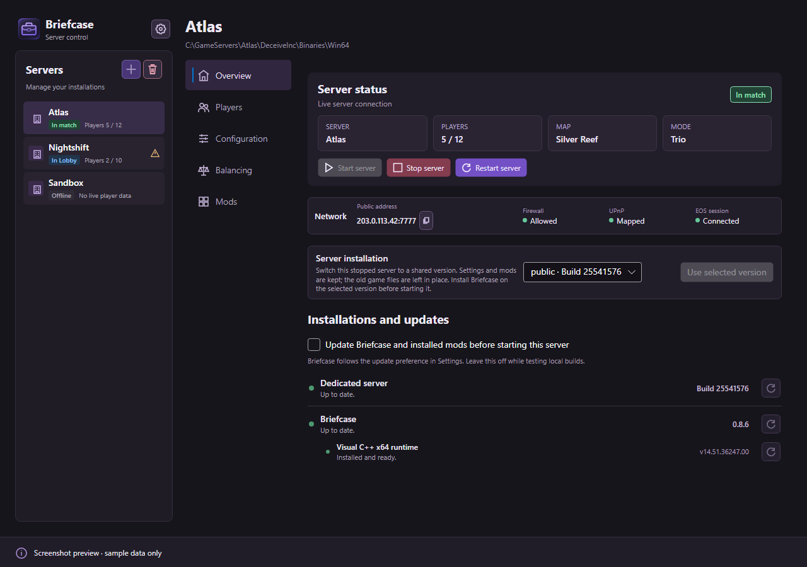

# Briefcase

**Run and manage Deceive Inc. dedicated servers from one Windows app.** Install a server, choose its settings and map rotation, see connected players, and manage Briefcase mods without using a command line.

## Download for Windows

### [⬇️ Download the latest Briefcase installer](https://github.com/EnoPM/Briefcase/releases/latest)

On the release page, open **Assets** and choose **`Briefcase-Setup-…-win-x64.exe`**. The files labelled *Source code* are for developers; you don't need them to install the app.

1. Run the installer and open **Briefcase** from the Start menu.
2. On first launch, follow the welcome screen to download the dedicated server, then create your server. You can also import an existing installation.
3. Use **Configuration** to choose your settings, then **Overview → Start server**.

The initial game-server download requires an internet connection and enough disk space. Briefcase runs on Windows x64. The app checks for its own updates when it starts.

## A look inside

The screenshots below use fictional servers and players.

[Connected players and teams](docs/screenshots/players.png) · [Balancing editor](docs/screenshots/balancing.png) · [Mod marketplace](docs/screenshots/marketplace.png)

Briefcase also supports several servers and app profiles, including separate data folders. You can configure game modes, bots, maps and balancing; install, update and configure mods; and follow live player and server status.

## Help and more information

- [Step-by-step guide](docs/UserGuide.md)
- [Latest release and download](https://github.com/EnoPM/Briefcase/releases/latest)
- [Report a problem](https://github.com/EnoPM/Briefcase/issues)
- [Developer release and installer details](docs/InstallerPlan.md)

## License and artwork

Briefcase's original source code is available under the [MIT license](LICENSE), consistent with BriefcaseNative and its mods. This license does not cover Deceive Inc. artwork in `Briefcase.ServerApp/Assets/Game/UI` or that artwork as shown in the screenshots. Rights to the game artwork remain with its owners; its use in this community application was permitted by the publisher. Third-party dependencies retain their own licenses.
